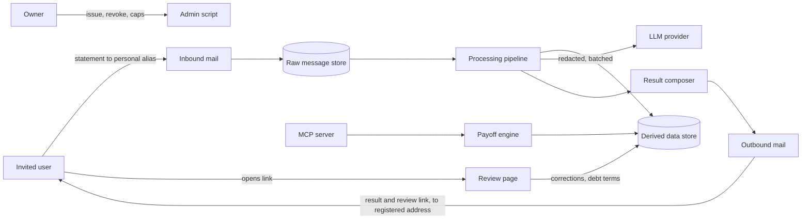

# AI Budget Buddy: Architect Vision

Status: Draft v0.1, October 23, 2026. Derived from Product Brief v0.1 (Oct 21) and the owner's demo direction: statements arrive by email, results go out by email, corrections happen on one small review page, and there are no accounts and no Gmail connection. Nothing here is decided until it is recorded as an ADR in [../adr/README.md](../adr/README.md). Decisions marked Proposed become ADRs once confirmed. This document is a vision, not a decision record, so it may be revised while the ADRs it points to are immutable once accepted.

## 1. Purpose

Define the target architecture for the invite-only demo and the principles that keep it small, safe and affordable. The demo exists to answer one question: will people send a real statement and find the result useful enough to come back? Every architectural choice is judged against that question and the $100 per month ceiling.

Demo shape: the owner invites a user and issues a personal email address. The user sends or forwards a bank statement to that address. The system parses it and emails the result, which includes a link to a one-page review where the user can correct categories and confirm debts. There are no accounts, no dashboard and no Gmail connection. The mailbox is the front door, and the link in the result email is the credential.

## 2. Principles

1. Deterministic code owns money. Parsing, recurrence detection, payoff math and dates are plain code with tests. The model never produces an amount or a date.
2. The model is used where rules fail: categorizing messy Armenian, transliterated, Russian and English merchant text, and explaining results in plain language.
3. Every AI component has a measured baseline and a deterministic fallback. No component ships without an evaluation result.
4. Raw statements are toxic data. Minimize where they go, how long they live, and what the model sees.
5. Add a pattern (agents, retrieval, MCP) only when a documented problem requires it. If it is rejected, the rejection is documented.
6. Spend is capped by design, not by vigilance.
7. An email address is not an identity. Who may submit and where results go are decided by the system's records, never by message headers.

## 3. System context

## 4. Key decisions

| ID | Decision | Alternatives | Status |
| --- | --- | --- | --- |
| AD-1 | Ingestion by inbound email to a per-user alias with an unguessable token; sender address is informational only | Web upload through a magic link; Gmail OAuth (post-demo) | Owner direction, pending ADR |
| AD-2 | Deterministic and LLM boundary as in principles 1 and 2 | LLM-driven debt detection and calculation | Proposed |
| AD-3 | Categorization as a cascade: rules, user corrections, then LLM for the remainder | LLM for everything; fine-tuned small model | Proposed, gated by eval |
| AD-4 | Fixed pipeline, no autonomous agents in v1 | Single tool-using agent; sub-agent orchestration | Proposed |
| AD-5 | Retrieval over education content deferred | RAG in v1 | Proposed |
| AD-6 | MCP server as a secondary interface to the deterministic engine | No MCP; MCP as the primary path | Proposed |
| AD-7 | Redact before the model, delete raw messages after processing | Send raw rows; retain files 24h | Proposed |
| AD-8 | Serverless on AWS, single region, hard spend caps | Always-on containers; managed container service | Proposed |
| AD-9 | Evaluation set as a release gate for categorization | Manual spot checks | Proposed |
| AD-10 | Results by email to the registered address, with a link to a one-page, server-rendered review page for corrections and debt confirmation; the link is the credential, scoped to one result | Spreadsheet round trip; reply grammar; free-text replies read by the model; static single-page app plus API; low-code tools; accounts | Owner approved (Oct 23), pending ADR |

## 5. Decision notes

### 5.1 Email ingestion and alias scheme (AD-1)

The owner invites a user and registers their email address. The system issues an alias on the demo domain, for example `k7f3q9x2m4ab@demo.example`, where the local part is a random token of at least 12 characters, not a sequential ID. The recipient address identifies the user. The sender address identifies nothing, because users forward from any mailbox, including temporary ones. This resolves the brief's open question on invited users who send from arbitrary addresses.

Properties of the scheme:

- The alias is a bearer secret for submission. Anyone who holds it can submit statements as that user. They cannot read results (see 5.2), so the worst cases are data pollution and spend, which per-user caps contain.
- Aliases are revocable and rate-limited. Revoking an alias stops processing and mail to it is dropped.
- Authentication verdicts (SPF, DKIM, DMARC) are recorded for logging and rate decisions, not used to reject. Forwarding commonly breaks SPF, so rejecting on it would drop legitimate submissions.
- A forwarded statement can arrive as a plain attachment, as an attachment of a forwarded message, or as an embedded original message, depending on the user's mail client. The parser must find the XLSX in each form. Fixtures cover Gmail, Outlook and Apple Mail forwards.
- Only XLSX is accepted. Anything else gets a short reply explaining what to send.
- Automated mail (out-of-office replies, bounces, delivery notices) is detected and ignored, and outbound mail is marked as auto-generated, so two mailboxes cannot reply to each other in a loop.

Email provider: the owner decides, for testing. Selection criteria, so the choice is made against the same list the ADR will use:

1. Accepts mail for arbitrary local parts on the demo domain, so aliases need no per-user mailbox.
2. Delivers the full raw message with attachments to storage or a webhook, with a size limit above a typical statement. Verify the limit.
3. Exposes SPF, DKIM and DMARC verdicts.
4. Sends outbound mail with DKIM signing and reports bounces and complaints.
5. Data handling: who stores the raw message, where, and for how long. Every third party that touches a statement is a processor that the consent notice must name.
6. Fits the $100 per month ceiling and the AWS hosting constraint.

A provider inside the same AWS account keeps raw statements with one processor. A hosted inbound-parse service adds a second processor. Polling an ordinary mailbox is the quickest for a first test, but it needs alias support from the mailbox (plus-addressing varies between providers and mail clients) and does not carry beyond a handful of users.

### 5.2 Result delivery and the review page (AD-10)

Results go to the address registered at invitation, not to the From or Reply-To of the incoming message. Headers are forgeable, and users forward from other addresses. Replying to the sender would let anyone who learns an alias read that user's financial summary. Cost: a user who wants results at a different address must be re-registered by the owner.

The result email is useful on its own, so a user who never opens the link still got an answer: the budget summary by category for the statement period, the monthly debt burden, the detected recurring payments with the values the system assumed, a debt-free estimate marked provisional until the user confirms the terms (dates and amounts come from the payoff engine only), and the link to the review page.

The review page is deliberately small. One page per result, no accounts, no dashboard, no history:

- A summary header.
- A table of transactions with a category dropdown taken from the fixed category list. The default view shows the uncertain ones first, with a toggle to show all. Each change saves immediately for this result, so there is no Save button. Creating or changing a per-user rule to apply a correction beyond this result requires separate confirmation through a link sent to the registered address; the result-scoped review session alone cannot authorize it.
- A section for each detected debt with inputs for balance, rate and end date. The updated plan is shown on the page.
- A "delete my data" button sends a separate confirmation link to the registered address; the result-scoped review session alone cannot authorize user-wide deletion. Emailing the word DELETE to the alias initiates the same confirmation flow, so a user without the review link can still delete.

The page is rendered by the backend. It needs no separate front-end build, no cross-origin setup and no token handling in browser scripts.

The link is the credential, the same idea as a password-reset link:

- The token is random (128 bits), stored hashed, scoped to one result, expiring (30 days is an assumption to be decided), and revocable.
- Opening the link shows a button, not data. Pressing it sends a POST that creates a short session cookie (HttpOnly, Secure, SameSite). Email security scanners that fetch links therefore cannot use up the token or trigger a change.
- Every change needs a CSRF token. The token is removed from the address bar after the exchange.
- Pages are served as no-store with a strict content security policy, no third-party scripts and no analytics, and with a no-referrer policy.
- An expired or revoked link shows "we will email you a new one" and sends it to the registered address. Nothing is revealed about the user.
- The first edit in any 24 hours sends one notification to the registered address, so misuse by someone who obtained the link would be visible.

Costs to accept:

- Anyone who has the link can view and edit that result, so a forwarded email is forwarded access. The expiry, the one-result scope and the notification limit the damage.
- The page shows full transaction rows, which is more than the email's summary. The original statement is already in the user's mailbox, so the added exposure is small, but the consent notice must say it.
- A small web attack surface returns to the design. It is one server-rendered page, but it is a surface.
- A link in the email can lower inbox placement. The link must be on the same authenticated domain as the sender.

Deliverability is a product risk, not a detail. A result that lands in spam looks like a user who never returned and corrupts the success metric. The sending domain needs SPF, DKIM and DMARC. Each invitation asks the user to confirm that a test message arrived in the inbox, and delivery status is recorded per result.

Results in the email contain aggregates and merchant categories, with no account numbers and no personal counterparty names. They land in an ordinary mailbox, and transport encryption is opportunistic, so the consent notice must say this.

### 5.3 Categorization (AD-3, AD-9)

Pipeline per transaction: normalize text (script, transliteration, casing, bank noise) → rules and a merchant dictionary for an initial category → matches from the user's authorized per-user correction rules, overriding the initial category when present → LLM only for transactions still uncategorized, batched, with structured output restricted to a fixed category enum and a confidence value → low confidence goes to the top of the user's review list.

The 90% accuracy target is meaningful only if the evaluation set is not circular. A synthetic set written by the same person or model that designs the prompts overstates accuracy. Required: a public synthetic set for reproducibility, plus a private held-out set derived from real statement formats and never committed. Report accuracy per category and per language mix, not only the aggregate. In the demo, the live correction rate is the real production metric.

Model choice (single prompted model, smaller model, fine-tune) is decided by the eval, not in advance. Provider choice (direct API versus AWS-hosted) is a separate ADR covering data handling terms, region, cost and measured Armenian quality.

### 5.4 Debt detection and payoff (AD-2)

Recurring-payment detection is deterministic (same counterparty, stable amount, regular cadence). The model may help label a counterparty as a lender or retailer, but the proposal always goes to the user for confirmation of type, balance, rate and end date. Payoff logic by debt type:

- Revolving (overdraft, card): rate-based strategies such as avalanche and snowball apply.
- Scheduled (ապառիկ installments, consumer loan, mortgage): the plan is built from payment schedules and cash flow. Rate ordering does not apply.
- ապառիկ cost structure is an unverified assumption. Verify against real plans before the engine is finalized.

The engine uses exact decimal arithmetic in AMD, with property-based tests and worked examples published in the repo.

### 5.5 Agents, sub-agents, retrieval, MCP (AD-4, AD-5, AD-6)

The workload is a fixed sequence: receive, parse, categorize, detect, calculate, compose, send. Sending the result is a pipeline step, not an agent. A pipeline is cheaper, faster, testable and auditable. An agent loop adds cost and nondeterminism for no gain here. Sub-agent orchestration is not justified at this size and is documented as rejected for v1, with the condition that would reopen it (open-ended user questions over their data that need multi-step tool use).

Retrieval is deferred. A small education corpus fits in a prompt, so a vector store adds infrastructure without benefit. It is reopened if the corpus outgrows the context budget.

MCP has a real role: exposing the payoff engine and budget queries as tools lets any MCP client use them, and it demonstrates the interface boundary. It is a secondary interface over the same engine, not the demo's main path.

### 5.6 Privacy and data lifecycle (AD-7)

- Raw messages go to private storage with encryption at rest, under per-user key prefixes.
- The pipeline attempts to delete the raw message and attachment as soon as parsing succeeds or fails, but queued messages may exceed 24 hours and processing may terminate before deletion. This does not guarantee deletion within 24 hours; do not claim that ceiling without independent age-based cleanup, deletion retries and failure monitoring. A storage lifecycle rule is a backstop only: expiration is configured in days and removal is asynchronous, with a delay AWS does not bound. The inbound provider's own retention must be confirmed and set as short as it allows.
- Before any model call: remove holder names and account numbers, and route person-to-person transfers by rule so counterparty names never reach the model. Name redaction on transliterated Armenian is imperfect, so rule-based routing is the safer control.
- Derived data is isolated per user and deleted on request, with a documented deletion path that is tested.
- Observability stores cost, latency, delivery status and correction counts. No raw descriptions, no message bodies and no review tokens in logs.
- The statement also remains in the user's own mailbox and sent items. That is theirs, but the invitation should say so.
- Consent: the invitation states what is processed, by whom, and for how long, including that the review page shows full transaction rows. Submitting a statement is logged as consent.
- Legal review is required before any launch beyond invited users.

### 5.7 Threat model summary

| Threat | Control |
| --- | --- |
| Malicious or malformed XLSX (macros, formula injection, decompression bombs) | Accept XLSX only, size limit, read-only parsing, ignore formulas, parse in an isolated function |
| Prompt injection through transaction descriptions | Descriptions treated as data, enum-constrained structured output, no tools or retrieval in the categorization call |
| Cross-user data exposure | Per-user prefixes and row-level scoping, tested with a negative suite |
| Alias leaked or guessed | Random token, revocation, per-user caps, results sent only to the registered address |
| Forged sender used to read results | Results never go to From or Reply-To; deletion by email needs a confirmation link sent to the registered address |
| Review link forwarded or leaked | One-result scope, expiry, revocation, no accounts or history reachable from it, notification email on edit |
| Email security scanners fetch the link | A GET shows only a button; the session is created by a POST |
| Cross-site request forgery or script injection on the review page | CSRF tokens, strict content security policy, output encoding of transaction text, no third-party scripts |
| Token exposed through logs or referrers | Token removed from the address bar after exchange, no-referrer policy, token hashed at rest and excluded from logs |
| Mail loops and auto-replies | Ignore automated mail, mark outbound as auto-generated, per-user outbound cap |
| Results filtered as spam | SPF, DKIM, DMARC on the sending domain; link on the same authenticated domain; inbox test at invitation; delivery status tracked |
| Cost abuse or runaway loop | Per-user token, upload and message caps, billing alerts, global kill switch |
| Bank format drift | Parser fails visibly, replies naming the unrecognized file or column, never guesses |

### 5.8 Deployment and cost (AD-8)

Shape: inbound mail handling, queue between receipt and processing, processing and composition on functions, one small web function and static assets for the review page, private object storage, a small managed relational store (the datastore choice is a pending ADR: money calculations and per-user scoping favor relational), secrets in a managed secret store, one region, infrastructure as code. There is no sign-in and no account store. The owner issues and revokes aliases with a small admin script. Line items to price before committing: compute, datastore, model usage, inbound and outbound mail, domain and certificate, logs. Controls: budget alerts, per-user caps, and a kill switch. Measured cost per processed statement is a published number, not an estimate.

## 6. Quality attributes

| Attribute | Target | Source |
| --- | --- | --- |
| Time to result | Result email sent within 5 minutes of receipt | Brief (assumption) |
| Categorization accuracy | At least 90% on the evaluation set | Brief (assumption), see 5.3 |
| Money correctness | Exact, fully tested | Brief |
| Deliverability | Result reaches the inbox for every invitee, checked at invitation | This document |
| Availability | Best effort | Brief |
| Cost | Within $100 per month, about $5 per user | Brief |
| Privacy | Raw messages deleted promptly, minimal derived data, deletion on request | Brief, see 5.6 |

## 7. Demo scope

Build: inbound mail handling with aliases, two bank parsers, categorization cascade with evaluation harness, debt detection, payoff engine, result email, one-page review with link-based access, deletion, cost and usage caps, admin script for aliases, minimal observability.

Document only: accounts and sign-in, dashboard and history, web upload, Gmail OAuth, additional banks and formats, Armenian interface and explanations, multi-agent orchestration, retrieval, native apps.

## 8. Risks specific to the architecture

- Armenian categorization may miss the target. Mitigation: cascade, user corrections, honest reporting of the result.
- Users may never open the review link. Mitigation: the result email is useful without it, and the correction rate is reported as a share of users who opened the page, not of all users.
- Deliverability may decide the demo result more than product quality. Mitigation: authenticated sending domain, inbox test at invitation.
- The review page reintroduces a small web attack surface. Mitigation: one server-rendered page, tokens scoped to one result, no third-party scripts, notification on edit.
- The demo success threshold (10 of 20 complete, 5 return) is small and likely drawn from friendly contacts, so a pass is weak evidence. Treat it as a floor for continuing, not as validation.
- Parser maintenance across two banks, and across mail-client forwarding forms, is the main recurring cost. Fixtures and visible failures limit it.
- Time: the Dec 28 to Jan 9 holiday window cannot hold critical-path work.

## 9. ADR backlog

ADR-0001 (record architecture decisions) is already accepted, so the backlog starts at 0002. Ordered by when the decision is needed, each following the MADR template with the cost of the choice stated:

| Number | Title | Vision decision |
| --- | --- | --- |
| 0002 | Ingestion by inbound email and the alias scheme | AD-1 |
| 0003 | Email provider and mail handling | owner decision, see 5.1 |
| 0004 | Result delivery and the review page | AD-10 |
| 0005 | Boundary between deterministic code and the model | AD-2 |
| 0006 | Datastore | pending |
| 0007 | Privacy and data lifecycle | AD-7 |
| 0008 | Categorization strategy and evaluation gate | AD-3, AD-9 |
| 0009 | LLM provider and hosting | pending |
| 0010 | Orchestration: pipeline versus agents | AD-4 |
| 0011 | Retrieval deferral | AD-5 |
| 0012 | MCP interface | AD-6 |
| 0013 | Deployment topology and cost controls | AD-8 |

## 10. Open questions

1. Link expiry for the review page (30 days is an assumption) and the final wording of the consent notice. To be settled in ADR-0004.
2. Email provider, chosen against the criteria in 5.1. To be recorded in ADR-0003.
3. Real ապառիկ plan terms, needed to validate the debt model before the payoff engine is finalized.
4. The private held-out evaluation set: who holds it and how it is kept out of the repository.
